<p align="center">
  <picture>
    <source media="(prefers-color-scheme: dark)" srcset="assets/baslik-koyu.svg">
    <source media="(prefers-color-scheme: light)" srcset="assets/baslik-acik.svg">
    
  </picture>
</p>

### Merhaba, ben SamurayJax 👋

İhtiyacım olan aracı bulamayınca kendim yapıyorum: animasyon motorları, masaüstü uygulamaları, oyun araçları. Her projede yapay zekâyla birlikte çalışıyorum; yavaş yavaş ama doğru şekilde.

## ⚔️ Projeler

<!--PROJELER:BASLA-->
#### 🎨 Animasyon ve oyun

- 🖌️ **EasyAnim** — Fırça, mürekkep ve ışıkla çalışan 2B animasyon motoru. Sunumlarımın görsel atölyesi.<br>`JavaScript` `Node.js` `SVG` · <sub>🔒 özel</sub>
- 🧱 **Roblox Animation Engine** — Tariften fiziğe uygun 3B karakter animasyonu üreten motor.<br>`Luau` `Roblox Studio` · <sub>🗺️ planlama</sub>
- ⛏️ [**Minecraft eklentileri**](https://github.com/SamurayJax?tab=repositories&q=Mc) — Klan davet sistemi, sohbet modu ve maske modu gibi eklentiler.<br>`Java` · <sub>🌐 açık kaynak</sub>

#### 🛠️ Masaüstü araçları

- 🎥 **EasyRec + EasyEdit** — Tek tuşla ekran kaydı, OBS'ten sade. Yanında kendi video düzenleyicisi geliyor.<br>`C#` `WPF` `.NET` · <sub>🔒 özel</sub>
- 🥋 **Dojo** — Projelerimi arkadaşların bilgisayarına tek tıkla kuran ve güncel tutan uygulama.<br>`Tauri` `Rust` · <sub>🔨 geliştiriliyor</sub>
- 🔎 **AramaPaneli** — Arama, çeviri ve video indirme için hepsi bir arada Chrome yan paneli.<br>`JavaScript` `Chrome` `Python` · <sub>🔒 özel</sub>

#### 🎲 DnD

- 🗺️ **DndOynatma** — DnD oturumları için sahne yönetimi: DM paneli ve oyuncu ekranı.<br>`TypeScript` `React` `Electron` · <sub>🔒 özel</sub>
- 🎙️ **DndSes** — DM'in sesini canlı değiştiren araç: ork, ejderha ve NPC sesleri Discord'a.<br>`Python` `Ses işleme` · <sub>🔒 özel</sub>

#### 🤖 Yapay zekâ ve otomasyon

- 📈 **StockMachine** — Al-sat yapmayan, yalnızca öneri üreten yatırım analiz botu. Öneriler Telegram'a gelir.<br>`Python` `GitHub Actions` `Telegram` · <sub>🔒 özel</sub>
- 🗣️ **Sophia** — Bir spor ve eğlence mekânı için yerelde çalışan, Türkçe konuşan sesli asistan.<br>`Python` `Whisper` `Ollama` · <sub>🗺️ planlama</sub>
<!--PROJELER:BITIR-->

<sub>🔒 Çoğu projenin kodu şimdilik özel depoda.</sub>

## 📊 İstatistikler

<!--ISTATISTIK:BASLA-->
📈 **57** katkı <sub>son 1 yıl</sub> · 🔨 **50** commit <sub>bu yıl</sub><br>
📦 **7** depo · 🔥 **1 gün** seri <sub>en uzun 3</sub>

**En çok kullandığım diller**

```text
TypeScript  ████████████░░░░░░░░  58.9 %
JavaScript  ██████░░░░░░░░░░░░░░  28.8 %
CSS         ██░░░░░░░░░░░░░░░░░░   7.7 %
Java        █░░░░░░░░░░░░░░░░░░░   4.1 %
HTML        ░░░░░░░░░░░░░░░░░░░░   0.4 %
```

<sub>son güncelleme 2026-11-25 · her gün kendiliğinden yenilenir</sub>
<!--ISTATISTIK:BITIR-->

## 🎲 Boş zamanlarımda

DnD oturumlarında **DM**'lik yapıyorum · kart sihri çalışıyorum · okumayı seviyorum.

## 📫 İletişim

✉️ recepcakan773@gmail.com

---

<sub>Başlık, kendi animasyon motorum EasyAnim'in fırçasıyla çizildi. Projeler ve istatistikler her gün GitHub Actions ile kendiliğinden yenilenir.</sub>
