

  <picture>
    <source media="(prefers-color-scheme: dark)" srcset="assets/baslik-koyu.svg">
    <source media="(prefers-color-scheme: light)" srcset="assets/baslik-acik.svg">
    
  </picture>

Merhaba, ben **SamurayJax** 👋

İhtiyacım olan aracı bulamayınca kendim yapıyorum: animasyon motorları, masaüstü uygulamaları, oyun araçları. Her projede yapay zekâyla birlikte çalışıyorum; yavaş yavaş ama doğru şekilde.

## ⚔️ Projeler

<table>
  <tr>
    <td><picture><source media="(prefers-color-scheme: dark)" srcset="assets/kart-easyanim-koyu.svg">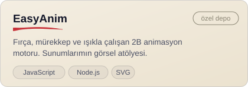</picture></td>
    <td><picture><source media="(prefers-color-scheme: dark)" srcset="assets/kart-roblox-animation-engine-koyu.svg">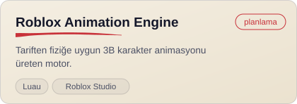</picture></td>
  </tr>
  <tr>
    <td><picture><source media="(prefers-color-scheme: dark)" srcset="assets/kart-easyrec-koyu.svg">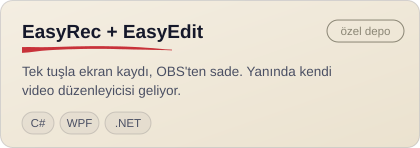</picture></td>
    <td><picture><source media="(prefers-color-scheme: dark)" srcset="assets/kart-dndoynatma-koyu.svg">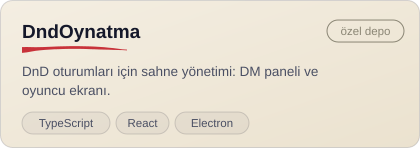</picture></td>
  </tr>
  <tr>
    <td><picture><source media="(prefers-color-scheme: dark)" srcset="assets/kart-dndses-koyu.svg">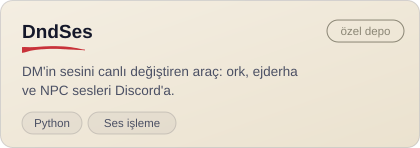</picture></td>
    <td><picture><source media="(prefers-color-scheme: dark)" srcset="assets/kart-dojo-koyu.svg">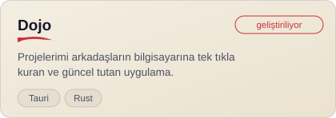</picture></td>
  </tr>
  <tr>
    <td><picture><source media="(prefers-color-scheme: dark)" srcset="assets/kart-aramapaneli-koyu.svg">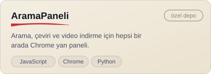</picture></td>
    <td><picture><source media="(prefers-color-scheme: dark)" srcset="assets/kart-stockmachine-koyu.svg">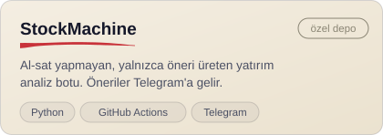</picture></td>
  </tr>
  <tr>
    <td><picture><source media="(prefers-color-scheme: dark)" srcset="assets/kart-sophia-koyu.svg">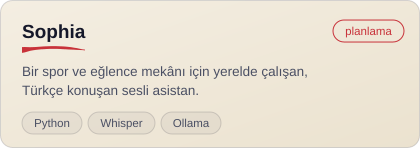</picture></td>
    <td><a href="https://github.com/SamurayJax?tab=repositories&q=Mc"><picture><source media="(prefers-color-scheme: dark)" srcset="assets/kart-minecraft-koyu.svg">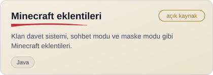</picture></a></td>
  </tr>
</table>

🔒 Çoğu projenin kodu şimdilik özel depoda.

## 📊 İstatistikler

<picture>
  <source media="(prefers-color-scheme: dark)" srcset="assets/istatistik-koyu.svg">
  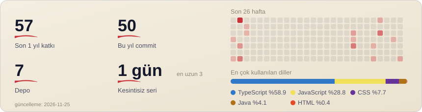
</picture>

## 🎲 Boş zamanlarımda

DnD oturumlarında **DM**'lik yapıyorum · kart sihri çalışıyorum · okumayı seviyorum.

## 📫 İletişim

✉️ recepcakan773@gmail.com

---

Başlık, kendi animasyon motorum EasyAnim'in fırçasıyla çizildi. İstatistikler her gün GitHub Actions ile kendiliğinden yenilenir.
